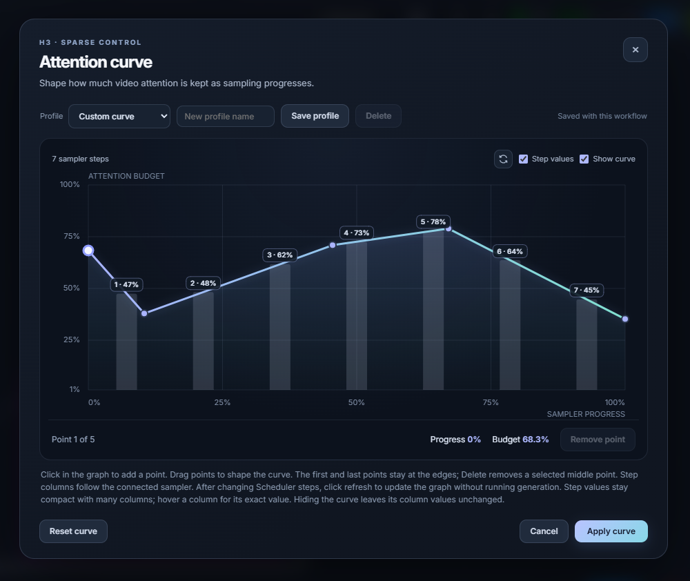

# H3 Sparse Attention (dan)

One ComfyUI model patch node for MiniMax H3, updated to the current **H3 Sparse Attention (Advanced)** behavior from Zironic/H3-Optimizations. Click **Edit attention curve** to open a graph editor and shape the video attention budget across sampler progress. The background columns use the step count read from the connected sampler or Scheduler. After changing Scheduler steps, click the refresh icon to update the count immediately without running generation. If the editor cannot find a connected sampler, it draws no columns and shows a translucent message in the graph asking you to retry with the refresh button. The attention curve and node operation remain unchanged. **Step values** shows column numbers and budgets, with fewer labels at high step counts and the exact hovered value on demand. **Show curve** hides or shows the curve and its control points; hiding them leaves the sampled columns and their values unchanged. Click in the graph to add curve points, drag to adjust them, and use Delete or Remove point to remove a selected middle point. Choose a saved curve profile or save your own; profiles are stored with the workflow. The start and end points stay anchored to the first and last sampler steps. The default curve matches the current eight-step Ramp schedule on a 20-step sampler: it starts at 68.33%, ramps toward 15%, then holds 15%. Audio, text, reference context, non-video queries, and mixed boundary tiles stay dense automatically; there is no Protect audio switch.

## Install

Copy this `H3-Sparse-Attention-dan` folder into `ComfyUI/custom_nodes` and restart ComfyUI. It registers only **H3 Sparse Attention (dan)**. ComfyUI 0.33.0 or newer with MiniMax H3 support is required. Explicit backends still require compatible GPU and runtime support; a selected unavailable backend raises an error, as in Advanced.

The packaged native backends cover Windows x64. No other nodes from either upstream repository are registered or required.

## Source

The sparse engine and Advanced settings follow the current H3 Sparse Attention (Advanced) implementation by Zironic, checked 2026-09-30. Its sparse route keeps audio, text, reference context, and mixed boundary tiles dense by default. This node retains a hidden legacy workflow field for old graphs, but always enables that protection and no longer shows a toggle. VSA-trained H3 checkpoints pass through unchanged so their trained sparse route remains intact. The curve editor and workflow-saved profiles are this package's additions.

The ComfyUI entry point and Python namespace were changed so this package exposes one node and can coexist with the original H3-Optimizations package.
